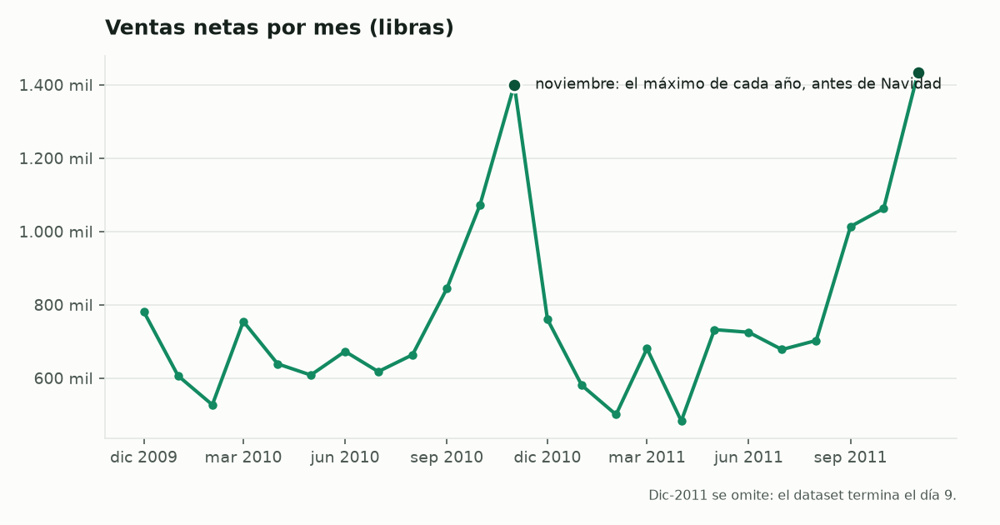
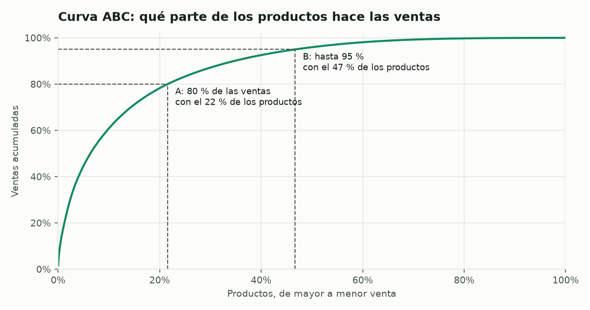
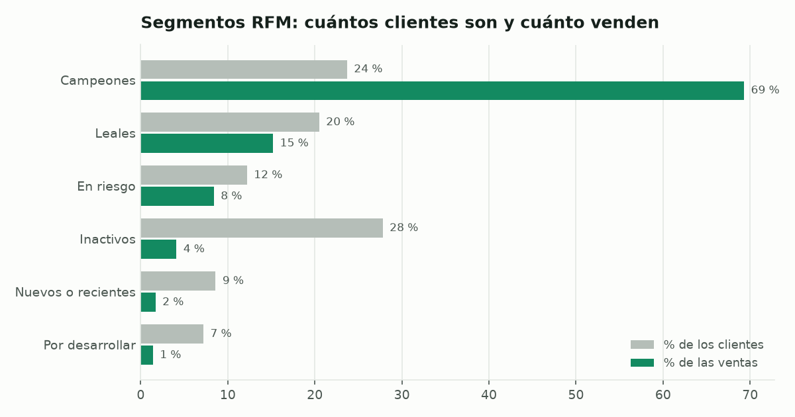
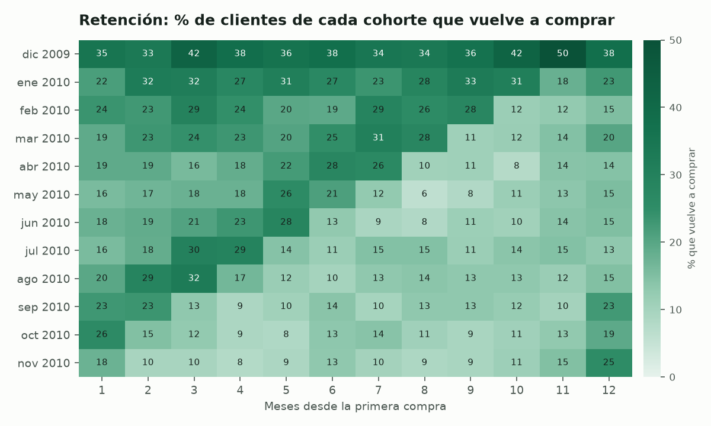

<div align="center">

# Mostrador: ventas con SQL

**Análisis de ventas, productos y clientes con SQL. Incluye un ejemplo chileno y permite cargar CSV o Excel.**

[**Abrir Mostrador**](https://vewachholtz-ops.github.io/analisis-ventas-sql/) | [**Usar mis ventas**](https://vewachholtz-ops.github.io/analisis-ventas-sql/#mis-ventas) | [Hallazgos](#hallazgos) | [Técnicas de SQL](#técnicas-de-sql-que-usa) | [Cómo se verifica](#cómo-se-verifica) | [Correrlo en tu computador](#correrlo-en-tu-computador)

[](https://github.com/vewachholtz-ops/analisis-ventas-sql/actions/workflows/ci.yml)


[](LICENSE)

</div>

## Datos para probar

- **Papelería chilena:** ventas simuladas entre 2023 y 2025, precios en CLP, productos en español y comunas de Santiago. Desde [Mostrador](https://vewachholtz-ops.github.io/analisis-ventas-sql/), elige «Probar el ejemplo chileno» y «Cargar ejemplo chileno». El [generador](scripts/ventas_ejemplo.py) permite reproducir el archivo; no son ventas de una empresa real.
- **Caso británico:** [Online Retail II](https://doi.org/10.24432/C5CG6D), datos reales de 2009–2011 publicados por UCI. Sus importes están en GBP. Este conjunto se conserva para comprobar las consultas contra resultados conocidos.
- **Archivo propio:** CSV o Excel, con selección de columnas, fechas, moneda y devoluciones. El archivo se procesa en el navegador.

## Qué analiza

Ventas mensuales, productos ABC, clientes RFM, retención, devoluciones, lugares y productos comprados juntos. La consola permite modificar las consultas y descargar sus resultados.

## Hallazgos

Estos resultados corresponden exclusivamente al [caso británico](https://vewachholtz-ops.github.io/analisis-ventas-sql/#caso-uci), en libras esterlinas.

<picture>
  <source media="(prefers-color-scheme: dark)" srcset="resultados/ventas-mensuales-oscuro.png">
  
</picture>

| Pregunta | Respuesta | Consulta |
|---|---|---|
| ¿Cuánto se vendió? | 18,98 millones de libras netas en dos años, después de descontar 0,72 millones cancelados | [`00_limpieza.sql`](sql/00_limpieza.sql) |
| ¿Creció el negocio? | Casi nada: +1,8 % el segundo año (9,35 contra 9,19 millones) | [`01_ventas_mensuales.sql`](sql/01_ventas_mensuales.sql) |
| ¿Qué tan estacional es? | Septiembre a noviembre hacen el 36 y el 38 % de las ventas de cada año; noviembre solo, el 15 % | [`01_ventas_mensuales.sql`](sql/01_ventas_mensuales.sql) |
| ¿Cuántos productos importan? | En el último año completo, el 22 % de los productos hace el 80 % de las ventas (clase A) y el 53 % solo hace el 5 % (clase C) | [`02_abc_productos.sql`](sql/02_abc_productos.sql) |
| ¿Quiénes son los clientes clave? | 1 de cada 4 clientes identificados (los "Campeones") hace el 69 % de las ventas con cliente identificado, o el 60 % del total (el 13,5 % de las ventas no tiene código de cliente) | [`03_rfm_clientes.sql`](sql/03_rfm_clientes.sql) |
| ¿Vuelven los clientes nuevos? | Solo 1 de cada 5 compra de nuevo al mes siguiente | [`04_cohortes.sql`](sql/04_cohortes.sql) |
| ¿Qué se cancela? | Un solo pedido de 80.995 unidades de *PAPER CRAFT, LITTLE BIRDIE* (168 mil libras), anulado el mismo día | [`05_devoluciones.sql`](sql/05_devoluciones.sql) |
| ¿Dónde se vende? | En el último año completo, 84,5 % en el Reino Unido; Países Bajos y Australia tienen pocos clientes con pedidos promedio de 2.400 a 3.000 libras | [`06_paises.sql`](sql/06_paises.sql) |
| ¿Qué se compra junto? | Productos de la misma colección: dos habitaciones de la casa de muñecas *Poppy's Playhouse* aparecen juntas en un pedido 33 veces más que si fuera al azar | [`07_canasta.sql`](sql/07_canasta.sql) |

"Último año completo" es de diciembre de 2010 a noviembre de 2011.

<picture>
  <source media="(prefers-color-scheme: dark)" srcset="resultados/curva-abc-oscuro.png">
  
</picture>

<picture>
  <source media="(prefers-color-scheme: dark)" srcset="resultados/rfm-oscuro.png">
  
</picture>

<picture>
  <source media="(prefers-color-scheme: dark)" srcset="resultados/cohortes-oscuro.png">
  
</picture>

**Ojo con la cohorte de diciembre de 2009:** el dataset parte ese mes, así que esa cohorte junta a todos los clientes que ya compraban antes. Por eso retiene más (35 % al mes siguiente, contra 20 % en promedio para las cohortes de enero a noviembre de 2010).

## La limpieza importa

Antes de cualquier análisis, [`00_limpieza.sql`](sql/00_limpieza.sql) aplica cinco reglas:

1. **Días repetidos:** la hoja 2010-2011 del Excel repite del 1 al 9 de diciembre de 2010, que ya están en la hoja 2009-2010. Se usan una sola vez.
2. **Ajustes contables:** las facturas que empiezan con `A` son ajustes de deuda, no ventas.
3. **Precio cero:** son muestras y ajustes de inventario.
4. **Códigos que no son productos:** `POST` (envío), `M` (manual), `DOT`, `BANK CHARGES` y similares. Se exige el patrón de producto: 5 dígitos y letras opcionales.
5. **Cancelaciones (facturas que empiezan con `C`):** se restan de las ventas en vez de ignorarse. (Las cohortes y la canasta usan las compras sin descontar cancelaciones: un pedido anulado igual cuenta como visita.)

La regla 5 cambia los resultados. El caso más claro está en [`05_devoluciones.sql`](sql/05_devoluciones.sql): un solo pedido de 80.995 unidades de *PAPER CRAFT, LITTLE BIRDIE* (168 mil libras) se canceló el mismo día. Si solo se suman las ventas, ese producto aparece entre los más vendidos con una demanda que nunca existió, y diciembre de 2011 se ve 40 % más grande de lo que fue.

## Técnicas de SQL que usa

- **Funciones de ventana:** acumulados para la curva ABC (`sum() OVER (ORDER BY … ROWS UNBOUNDED PRECEDING)`), quintiles para RFM con `rank()` para que dos clientes empatados reciban el mismo puntaje (con `ntile()` el empate se reparte al azar y el resultado cambia entre corridas), retención relativa a la cohorte (`first_value() OVER (PARTITION BY …)`) y un nombre por producto con `QUALIFY row_number() …`.
- **Agregaciones condicionales** con `FILTER (WHERE …)` para separar ventas y cancelaciones en una sola pasada.
- **CTEs encadenadas** y **vistas** que reutilizan la limpieza en todas las consultas.
- **Autojoin** para encontrar pares de productos en el mismo pedido (análisis de canasta con soporte, confianza y lift).
- **Comparación interanual por fecha** (`LEFT JOIN … ON mes = mes - INTERVAL 12 MONTH`), que no se rompe si falta un mes, a diferencia de `lag(…, 12)`.

## Cómo funciona la app

Mostrador es una página estática (React, Observable Plot y CodeMirror) publicada en GitHub Pages; no tiene servidor. Las tablas de [`resultados/`](resultados/) y las consultas de [`sql/`](sql/) entran a la página al construirla, así que el informe se ve al instante con los mismos números del repo. DuckDB-WASM se carga solo cuando alguien corre una consulta: baja las 1.067.371 líneas originales (en formato Arrow, comprimidas a 6 MB; DuckDB las lee sin extensiones) y crea las mismas vistas que `00_limpieza.sql`.

Con «Usar mis ventas», DuckDB lee el archivo propio directo desde el disco (un Excel se pasa antes a CSV en la misma página, con [fflate](https://github.com/101arrowz/fflate)). Las columnas elegidas se convierten a una tabla con la misma forma que la del dataset (`factura`, `fecha`, `codigo`, `cantidad`, `precio`, `cliente`, `pais`) y sobre ella se crean las mismas vistas, así que las consultas de `sql/` corren casi sin cambios: las fechas fijas del dataset pasan a ser el primer y el último mes del archivo, y el mínimo de pedidos para la canasta crece con el tamaño del archivo.

## Cómo se verifica

- [`tests/test_sql.py`](tests/test_sql.py) arma un dataset de 15 líneas con un caso de cada regla de limpieza: una línea repetida entre hojas, un ajuste `A`, un código `POST`, un precio cero, una cancelación y una descripción con espacios sobrantes. Cada consulta se compara con un resultado calculado a mano: totales, variación anual, clases ABC, puntajes y segmentos RFM (con empates), retención por cohorte y el lift de cada par de productos. Además, dos corridas seguidas sobre los datos reales dan exactamente las mismas tablas.
- [`tests/test_web.py`](tests/test_web.py) comprueba que los datos que usa la app son las 1.067.371 líneas del Excel y que con ellos las ocho consultas dan, carácter por carácter, los CSV de `resultados/`.
- [`tests/test_navegador.py`](tests/test_navegador.py) abre la app en Chromium, corre las ocho consultas con DuckDB-WASM y exige «8 de 8 iguales a resultados/»; también prueba la consola y «Usar mis ventas» con dos archivos ajenos: el CSV de la papelería (punto y coma, fechas día-mes-año, pesos con punto de miles) y un Excel armado en la prueba, cuya venta neta tiene que dar lo calculado en Python.

GitHub Actions corre todo en cada cambio. Comparar el navegador con Python encontró un error real: un cliente que canceló todo lo que compró suma 0, pero en punto flotante podía dar 0,00000000000003 y contarse como cliente con compras. Ahora `03_rfm_clientes.sql` redondea al centavo y los dos motores dan lo mismo.

## Correrlo en tu computador

Requiere [uv](https://docs.astral.sh/uv/) y, para la app, [Node.js](https://nodejs.org/) 22.

```bash
uv sync
uv run ventas                       # la primera vez descarga los datos (45 MB); después, unos 8 segundos
uv run python scripts/datos_web.py  # la copia de los datos para la app
uv run pytest                       # las pruebas de SQL y de los datos de la app

cd interfaz
npm ci
npm run dev                         # la app en http://localhost:5173
```

Para las pruebas en el navegador: `VITE_DUCKDB=local npm run build` dentro de `interfaz/` (incluye DuckDB en la página, sin pedirlo a internet), luego `uv run playwright install chromium` y `uv run pytest tests/test_navegador.py`.

Cada archivo de [`sql/`](sql/) también se puede correr solo en el CLI de DuckDB, después de crear la vista `crudo`:

```sql
CREATE VIEW crudo AS SELECT * FROM 'datos/online_retail_ii.parquet';
.read sql/00_limpieza.sql
.read sql/02_abc_productos.sql
```

## Estructura

```
sql/              # las 8 consultas, numeradas en el orden en que se corren
resultados/       # una tabla CSV por consulta, la curva ABC y los gráficos de este README
src/ventas/
  cargar.py       # descarga el Excel de UCI y lo convierte a Parquet
  analisis.py     # corre las consultas y genera tablas y gráficos
scripts/
  datos_web.py    # la copia de los datos para la app (Arrow comprimido)
  ventas_ejemplo.py  # las ventas inventadas de una papelería, para probar «Usar mis ventas»
interfaz/         # la app web (React + DuckDB-WASM), publicada con GitHub Pages
tests/            # dataset inventado, datos de la app y pruebas en el navegador
```

## Datos

**Online Retail II**, de Daqing Chen. UCI Machine Learning Repository, 2019. <https://doi.org/10.24432/C5CG6D>. Licencia [CC BY 4.0](https://creativecommons.org/licenses/by/4.0/). Transacciones de una tienda online del Reino Unido que vende artículos de regalo, en buena parte a mayoristas, entre el 1 de diciembre de 2009 y el 9 de diciembre de 2011. El Excel no se sube al repo (`uv run ventas` lo descarga); la app incluye una copia de las mismas líneas, sin cambios, en `interfaz/public/datos/`. Detalle de los datos y del código de terceros: [TERCEROS.md](TERCEROS.md).

Licencia MIT.

